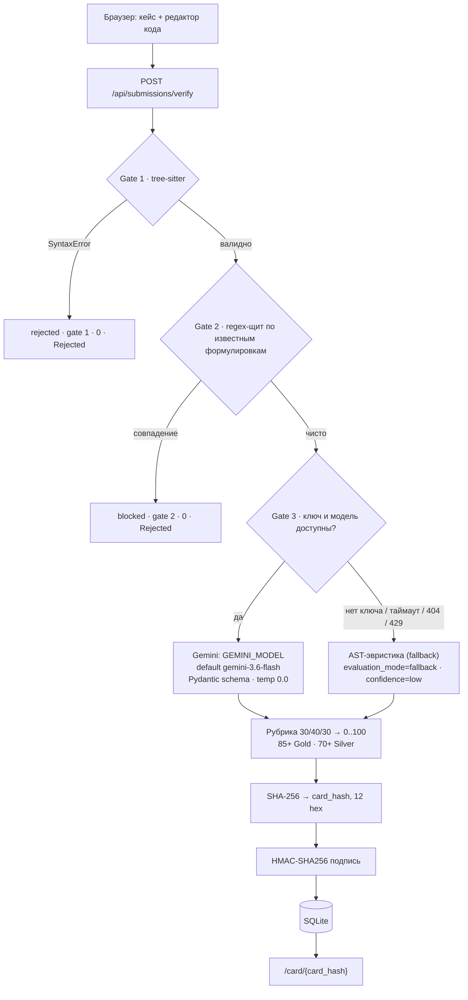

# Merilo — 3 шлюза проверки кода и публичная Verified Skill Card

**Короткий инженерный кейс вместо чтения резюме:** кандидат решает рабочую задачу в браузере, конвейер из трёх шлюзов оценивает код по рубрике 30/40/30 и выпускает подписанную карточку, которую работодатель открывает по ссылке.

[](https://python.org)
[](https://fastapi.tiangolo.com)
[](https://ai.google.dev)
[](https://sqlite.org)
[](tests)
[](https://hackathon.kz)

National Founder Cup 2026 (Шымкент) · кейс 5 «The Experience Gap» · команда **Merilo Found** (solo developer: Marat Zholynbek).

Публичный репозиторий: **https://github.com/MaratelloMaJo/merilo** · демо: **https://merilo-nfc.fly.dev**

---

## Скриншоты и инфраструктура

Скриншоты (`screenshots/`), офлайн-страница (`docs/offline-demo.html`) и презентация (`docs/presentation.html`) лежат в репозитории. Docker, `.dockerignore`, `fly.toml`, `render.yaml` и CI-workflow — в корне (`Dockerfile`, `.dockerignore`, `fly.toml`, `render.yaml`, `.github/workflows/ci.yml`); бинарные экспорты презентации в публичное дерево не входят.

Демо для жюри: **https://merilo-nfc.fly.dev** (снимок 2026-11-13 отдавал три Python-кейса; финальная сборка с восемью задачами деплоится из `main`).

### Публичный сайт и рабочее пространство

- Главная страница открывается в роли кандидата. В шапке только три раздела — «Стенд», «Как это работает», «Вопросы» — плюс переключатель темы, язык, кнопка **HR-Портал** и аккаунт. Переключателя «Кандидат / HR» в шапке больше нет.
- **`/help`** — отдельная страница-руководство: три шага проверки, что внутри карточки и частые вопросы. Ссылка на неё живёт в подвале и мобильном меню.
- **`/app`** — единое рабочее пространство. Роль решает вид: кандидат видит обзор, свои карточки, задания и профиль; рекрутер — прежние экраны найма. Демо-режим подставляет вымышленного кандидата, реальные данные появляются после входа.
- Регистрация сохраняет основную роль и сессию в HttpOnly cookie `merilo_session`. Вторую роль (кандидат ↔ HR) можно добавить в профиле через `POST /api/auth/roles`; аккаунт при этом остаётся один.
- Тёмная тема следует системной настройке (`prefers-color-scheme`) и переключается вручную. Выбор запоминается в `localStorage["merilo.theme"]`; `?theme=light` и `?theme=dark` позволяют открыть конкретную тему по ссылке.

---

## Проблема

Джуниору нечего приложить к отклику, кроме резюме и учебных проектов, а малой продуктовой компании (10–100 человек) нечем быстро проверить, умеет ли человек писать код: тестовое задание готовит и проверяет тот же тимлид, у которого нет отдельной функции оценки. Генеративные модели удешевили производство правдоподобного кода, поэтому чтение документов перестало быть дешёвым фильтром.

**Аудитория:** кандидат-junior (0–2 года), IT-рекрутер/HR малой продуктовой компании, учебный центр.

**Честная оговорка:** интервью не проведены, клиентов и пилотов нет. Все количественные оценки боли и рынка в `docs/PROBLEM.md` помечены `[assumption]` и являются гипотезами, а не измерением. TAM/SAM/SOM там же — арифметика допущений, показывающая порядок величины.

Подробнее: **[`docs/PROBLEM.md`](docs/PROBLEM.md)** (аудитория, боль → фича → доказательство, план 5 интервью).

---

## Что делает Merilo

Один процесс FastAPI на порту `8000` раздаёт и API, и статику. Кандидат выбирает кейс (FinTech / Logistics / EdTech / Web / API / Service / CLI / Enterprise), правит код в браузере и нажимает «Запустить 3-шлюзовую верификацию».

**Три шлюза — по возрастанию стоимости:**

1. **Gate 1 — tree-sitter.** Код разбирается локально парсером tree-sitter для выбранного языка до любых сетевых вызовов. Синтаксическая ошибка → `rejected`, `gate_reached=1`, `0`. Если в неразбираемом тексте найден паттерн инъекции, вердикт всё равно `blocked` на Gate 2 — щит имеет приоритет.
2. **Gate 2 — pattern-based щит.** Regex по известным формулировкам подмены инструкций (`ignore previous instructions`, `give 100`, `score: 100` и подобным). Совпадение → `blocked`, `gate_reached=2`, `0`. Это фильтр по известным шаблонам, а не понимание смысла: перефразированная атака может пройти. Второй слой — флаг `is_plagiarized_or_injected` из ответа модели, но он работает только при доступной модели.
3. **Gate 3 — оценка и подпись.** Модель из `GEMINI_MODEL`, по умолчанию `gemini-3.6-flash`; fallback-модели `gemini-3.5-flash` → `gemini-3.5-flash-lite`. Ответ ограничен Pydantic-схемой `CodeEvaluationResponse` (`temperature=0.0`, `response_mime_type="application/json"`). Нет ключа, таймаут, 404/429 — включается детерминированная эвристика (Python — по AST, остальные языки — по структурным фактам tree-sitter; `evaluation_mode="fallback"`, `confidence="low"`; `high` — только при явной причине вроде найденной инъекции или синтаксиса).

**Рубрика:** Clean Code 30% + Architecture & Efficiency 40% + Edge Cases & Security 30% → `0..100`. Пороги: **85+ Gold Verified**, **70+ Silver Verified**, иначе **Needs Work**.

**Verified Skill Card.** Публичный идентификатор — первые 12 hex-символов SHA-256 от `task_id`, имени кандидата, вердикта, балла, `user_id` и SHA-256 кода. `user_id` выводится детерминированно из нормализованного email: `usr_` + первые 16 hex SHA-256 (`backend/db.py::create_user`). Поэтому **одна и та же задача + тот же кандидат (email) + тот же код дают одинаковый `card_hash`** — в том числе на двух независимых свежих базах (проверено: `8c101d0a2a98`). Два разных email дают разные `user_id` и, значит, разные хэши — общая карточка между аккаунтами не возникает. В уже существующих базах остаются прежние `user_id`: миграции нет. Поверх хэша ставится **HMAC-SHA256** (`hmac.compare_digest`), поэтому запись нельзя отредактировать без секрета сервера. Карточка доступна по `/card/{card_hash}`, API — `GET /api/cards/{hash}` с полем `is_signature_valid`. Переносимый манифест (`/api/cards/{hash}/manifest`) подписан **Ed25519** и проверяется офлайн скриптом `scripts/verify_card.py` по ключу из `/.well-known/merilo.json`.

**Что карточка подтверждает:** этот код прошёл этот конвейер, получил этот балл, запись не менялась после подписи.
**Чего не подтверждает:** авторство кода, личность кандидата, уровень инженера (рубрика не откалибрована на людях).

### Языки

Тринадцать языков проходят Gate 1 (tree-sitter) и Gate 2 (щит по известным формулировкам). Семантическая рубрика откалибрована в первую очередь для Python и JavaScript — для остальных языков качество оценки не измерялось, и «production-grade» мы не заявляем.

| Язык | Ключ API | Разбор | Рубрика |
|:---|:---|:---|:---|
| Python | `python` | tree-sitter | калибруется первой |
| JavaScript | `javascript` | tree-sitter | калибруется первой |
| TypeScript | `typescript` | tree-sitter | не калибрована |
| Java | `java` | tree-sitter | не калибрована |
| Go | `go` | tree-sitter | не калибрована |
| C# | `csharp` | tree-sitter | не калибрована |
| C++ | `cpp` | tree-sitter | не калибрована |
| C | `c` | tree-sitter | не калибрована |
| Rust | `rust` | tree-sitter | не калибрована |
| Ruby | `ruby` | tree-sitter | не калибрована |
| PHP | `php` | tree-sitter | не калибрована |
| Kotlin | `kotlin` | tree-sitter | не калибрована |
| Swift | `swift` | tree-sitter | не калибрована |

Источник состава — `backend/languages.py` (`SUPPORTED_LANGUAGES`, ровно 13 ключей); состав закреплён тестами `tests/test_languages.py` и `tests/test_static_contract.py`.

### Проверка карточки без Merilo

Манифест карточки — обычный JSON, подпись — Ed25519. Публичный ключ и контракт лежат в `GET /.well-known/merilo.json`. Офлайн-проверка не требует ни базы, ни секрета платформы:

```bash
curl -s http://127.0.0.1:8000/api/cards/{hash}/manifest > manifest.json
python scripts/verify_card.py --file manifest.json
# VALID
```

Проверено 2026-11-13: реальный манифест даёт `VALID`, а изменённое поле — `INVALID` и exit 1. Ответ `GET /api/cards/{hash}` содержит 27 публичных ключей и не содержит `submitted_code`, `user_id` и `defense_token`.

---

## Quickstart

Нужен Python 3.11+. Внешних сервисов, npm и сборщиков нет.

**Windows PowerShell**

```powershell
python -m venv .venv
.\.venv\Scripts\Activate.ps1
python -m pip install -r requirements.txt
python scripts\run_demo.py
```

**Linux / macOS**

```bash
python3 -m venv .venv
source .venv/bin/activate
python -m pip install -r requirements.txt
python scripts/run_demo.py
```

`scripts/run_demo.py` принимает `--host`, `--port` (по умолчанию `8000` или env `PORT`), `--no-browser`, `--reload`. Если порт занят: `python scripts/run_demo.py --port 8010`.

**Без ключа (по умолчанию).** Настраивать нечего: сервер считает оценки детерминированной AST-эвристикой, сетевых вызовов нет. Проверка режима:

```powershell
curl.exe http://127.0.0.1:8000/api/ready
# {"ready":true,"db":"ok","gemini_key":false,"model":"gemini-3.6-flash","mode":"fallback"}
```

**С ключом (живая модель).**

```powershell
Copy-Item .env.example .env          # Linux/macOS: cp .env.example .env
$env:GEMINI_API_KEY = "ваш-ключ"     # или $env:LLM_API_KEY
python scripts\run_demo.py
```

```bash
export GEMINI_API_KEY="ваш-ключ"     # или export LLM_API_KEY
python scripts/run_demo.py
```

Приложение читает переменные окружения напрямую через `os.getenv`; `python-dotenv` не подключён, поэтому `.env` — только памятка значений, а переменную нужно выставить в текущей сессии (либо запустить `python-dotenv run -- python scripts/run_demo.py`).

**Проверка живости.**

```powershell
curl.exe http://127.0.0.1:8000/api/health
# {"status":"ok","mode":"demo_active","version":"...","model":"gemini-3.6-flash","db":"ok"}
```

Открывать `http://127.0.0.1:8000/`, а не файл с диска.

**API.** Полный справочник с `curl`-примерами для всех маршрутов — **[`docs/API.md`](docs/API.md)**; интерактивная схема — `http://127.0.0.1:8000/docs`, машинная — `/openapi.json`. Evidence-слой, на который ссылается лендинг: `/evidence` — оглавление, `/evidence/{labor_market.json|evidence|pilot|interviews|api}` — HTML-рендер документов (JSON отдаётся как JSON).

---

## Демо за 60 секунд

1. Открыть `http://127.0.0.1:8000/` — zero-auth, логин не нужен.
2. Выбрать кейс `FinTech` (`task-fintech-01`) и нажать `✨ Эталон (Clean & Secure)`.
3. Нажать «Запустить 3-шлюзовую верификацию» — шлюзы загораются по очереди.
4. Нажать «Открыть Verified Skill Card» — откроется `/card/{hash}` с баллом, рубрикой, хэшем и статусом HMAC.

Второй круг для жюри: пресеты `⚠️ Черновик с дефектом` (компилируется, но архитектура провалена → Needs Work) и `🛡️ Тест на инъекцию` (`blocked` на Gate 2, балл 0).

Полный тайминг, ожидаемые вердикты, стоп-лист фраз и план «Б» — в **[`docs/DEMO.md`](docs/DEMO.md)**.

**Если упал Wi-Fi:** стили лежат локально (`static/merilo.css`), поэтому вёрстка не зависит от CDN и остаётся на месте. API продолжит работать; показывайте `curl.exe`, скриншоты и `docs/offline-demo.html` — она открывается с диска без сервера и показывает три реальных fallback-прогона.

---

## Архитектура



| Модуль | Ответственность |
|:---|:---|
| `backend/main.py` | HTTP-слой: `/api/health`, `/api/ready`, `/api/tasks`, `/api/submissions/verify`, `/api/cards/{hash}`, `/api/cards/{hash}/manifest`, `/api/cards/{hash}/defense`, `/badge/{hash}.svg`, `/card/{hash}`, `/card/{hash}/qr.svg`, `/.well-known/merilo.json`, `/evidence` и `/evidence/{document}`, `/offline-demo.html` (статика с диска, не маршрут), middleware (`X-Request-ID`, `X-Response-Time`), rate limit, раздача `static/` |
| `backend/verifier.py` | Три шлюза, вызов модели, рубрика, `card_hash`, сборка ответа |
| `backend/languages.py` | 13 tree-sitter-грамматик, единый разбор без исполнения кода |
| `backend/signing.py` | Ed25519-манифест, публичный ключ, SVG-бейдж и QR |
| `backend/defense.py` | Одноразовый токен защиты, канонический хэш ответов, состояние защиты |
| `backend/fallback_cache.py` | Детерминированная AST-эвристика офлайн-режима; `INJECTION_KEYWORDS` |
| `backend/db.py` | SQLite (соединение на операцию, WAL), HMAC-подпись и проверка, scrypt для пароля |
| `backend/schemas.py` | Pydantic v2-контракты и JSON-схема ответа модели |
| `backend/seed_data.py` | Восемь кейсов с пресетами (ideal / vulnerable / injection): Python ×3, JavaScript, TypeScript, Java, Go, C# |
| `static/` | `index.html`, `card.html`, `app.js`, `i18n.js`, `merilo.css` — собственный CSS + Vanilla JS, без CDN |

**Данные.** Демо работает на SQLite (`backend/merilo.db`, путь переопределяется `MERILO_DB_PATH`); схема и сидинг создаются в `lifespan`. `sql/supabase_schema.sql` — production-blueprint для PostgreSQL: 5 таблиц, индексы и RLS-политики. **RLS в демо не активен**: SQLite эти политики не применяет, файл — декларация архитектуры, а не работающая защита.

---

## Архитектурные решения

Почему проект выглядит именно так — в пяти коротких ADR: контекст, решение, альтернативы, последствия и доказательства. Каждое решение можно проверить по ссылкам на файлы и тесты.

| ADR | Решение | Компромисс, который мы принимаем осознанно |
|:---|:---|:---|
| [ADR-001](docs/decisions/ADR-001-single-port-monolith.md) | Один процесс FastAPI раздаёт и API, и статику | Нет сборки и CORS, но нет и code splitting |
| [ADR-002](docs/decisions/ADR-002-three-gate-pipeline.md) | Три шлюза по возрастанию стоимости | Regex не понимает смысл атаки — это написано прямо |
| [ADR-003](docs/decisions/ADR-003-sqlite-demo-postgres-blueprint.md) | SQLite в демо, PostgreSQL + RLS как blueprint | RLS в демо не активен |
| [ADR-004](docs/decisions/ADR-004-card-hash-and-hmac.md) | Детерминированный `card_hash` + HMAC-подпись | HMAC — доверие серверу, не публичная криптография |
| [ADR-005](docs/decisions/ADR-005-deterministic-fallback.md) | AST-fallback вместо заготовленных оценок | Эвристика грубее модели, и она это не скрывает |

Индекс и правила ведения записей: [`docs/decisions/README.md`](docs/decisions/README.md).

---

## Тесты и метрики

```powershell
python -m pytest -q --cov=backend --cov-fail-under=80
python -m compileall -q backend tests scripts
python -m ruff check backend tests scripts
node --check static/app.js
```

| Проверка | Результат (2026-11-13, локальный Windows, Python 3.14.6) |
|:---|:---|
| `pytest` + coverage | **397 passed**, покрытие **85,30 %** (2240 из 2626 инструкций) при пороге 80 % |
| `compileall` | exit 0 |
| `ruff check` | All checks passed |
| `node --check static/app.js` | exit 0 |
| `docker build -t merilo-final .` | exit 0, образ **326 МБ**, `python:3.12-slim`, только wheels — компилятор в образе не нужен |
| container smoke | все маршруты 200 по списку из `docs/FINAL_AUDIT.md`; `uid=10001`, `HEALTHCHECK` → `healthy` |

Тестовые модули (21 + `conftest.py`): `test_ast_gate`, `test_injection_shield`, `test_fallback`, `test_gemini_mock` (404/429/timeout/retry/cache без сети), `test_api_contract`, `test_card_hash`, `test_db`, `test_rate_limit`, `test_health`, `test_secrets`, `test_badge`, `test_defense`, `test_defense_api`, `test_demo_session`, `test_design_contract`, `test_languages`, `test_multilang_api`, `test_profile_api`, `test_signing`, `test_static_contract`, `test_claims`.

**Латентность.** Замер на порту 8019, без Gemini-ключа, временная SQLite, n=20 на операцию, 2026-11-13:

| Операция | p50 | p95 |
|:---|:---|:---|
| `GET /api/health` | 6,53 мс | 7,17 мс |
| `POST /api/submissions/verify` (fallback) | 82,97 мс | 89,23 мс |
| `get_fallback_evaluation` (in-process) | 15,66 мс | 16,87 мс |

HTTP-числа зависят от машины и не переносятся на другое железо. `/api/ready` в этом прогоне: `mode=fallback`, `model=gemini-3.6-flash`. Источник модели — переменная `GEMINI_MODEL`; в замере действовало значение по умолчанию `gemini-3.6-flash`, ключ отсутствовал, поэтому все оценки получены fallback-эвристикой.

**Живая модель не измерялась.** Ключ намеренно не использовался: p50/p95 live-режима у нас нет, и мы не заявляем скорость Gemini. При ключе добавляется сетевой вызов с таймаутом 6 с и общим бюджетом 12 с на цепочку моделей; при исчерпании — fallback.

**Пресеты, `task-fintech-01`, кандидат «Evidence Check»** — прогон 2026-11-13 на временной базе, без ключа. Баллы и вердикты воспроизводятся; хэши зависят от `user_id` и имени кандидата, поэтому на другой базе будут другими. Наблюдалось, не гарантия:

| Пресет | `status` | `gate_reached` | Балл | Бейдж | `card_hash` |
|:---|:---|:---|:---|:---|:---|
| ideal | `verified` | 3 | 90 | Gold Verified | `c43265a13d32` |
| vulnerable | `verified` | 3 | 52 | Needs Work | `30f12dd6503c` |
| injection | `blocked` | 2 | 0 | Rejected | `8e13849df633` |

Повторная отправка ideal дала тот же `card_hash` — и при ручном прогоне, и в 20 вызовах бенчмарка. `GET /api/cards/c43265a13d32` → `is_signature_valid=true`, 27 публичных ключей. Балл зависит от источника оценки и калибровки: со сцены называйте тир, а не число.

---

## Security

`.env` не коммитится (в `.gitignore`, проверяется `git check-ignore -v .env`), в репозитории лежит `.env.example` с пустыми значениями.

| Переменная | Назначение |
|:---|:---|
| `MERILO_ENV` | `development` / `production`. В production без `MERILO_HMAC_SECRET` приложение падает на старте (`RuntimeError`) — fail-fast, а не тихий дефолт |
| `MERILO_HMAC_SECRET` | Секрет HMAC-SHA256 для подписи карточек и сессий. В dev без него создаётся эфемерный секрет и печатается warning |
| `MERILO_DEMO_PASSWORD` | Пароль демо-аккаунта при первичном сидинге; иначе генерируется случайный. В development он печатается один раз в консоль; в production (`MERILO_ENV=production`) — **не печатается**, в логах только `demo login disabled: set MERILO_DEMO_PASSWORD to enable it` (проверено) |
| `GEMINI_API_KEY` / `LLM_API_KEY` | Ключ живой модели; без него — fallback. Приоритет у `GEMINI_API_KEY` |
| `GEMINI_MODEL` | id модели, по умолчанию `gemini-3.6-flash`; резерв — `gemini-3.5-flash` → `gemini-3.5-flash-lite` |
| `MERILO_DB_PATH` | Путь к SQLite-файлу (по умолчанию `backend/merilo.db`) |
| `RATE_LIMIT_MAX_REQUESTS`, `RATE_LIMIT_WINDOW_SECONDS` | Окно rate limit для verify (по умолчанию 20 запросов / 60 с на IP) |

**Ротация секрета.** Сгенерировать новый, заменить в окружении, перезапустить:

```powershell
python -c "import secrets; print(secrets.token_hex(32))"
```

После ротации ранее выданные карточки перестают проходить проверку подписи (`is_signature_valid=false`) — их нужно перевыпустить. Сравнение подписей идёт через `hmac.compare_digest`, не через `==`.

**Обработка ошибок.** Пустой код и невалидный UTF-8 → 400, тело > 64 KB → 413, неизвестный `task_id`/`card_hash` → 404, ошибка валидации → 422 в JSON-конверте, превышение лимита → 429. Bare `except` в коде нет (`git grep -n "except:" -- backend` пусто). Тесты: `tests/test_secrets.py` (10 тестов), `test_api_contract.py`, `test_rate_limit.py`.

**Ограничения демо, а не production-контура:** CORS открыт (`allow_origins=["*"]`), `/api/tasks` и `/api/submissions/verify` работают без аутентификации (zero-auth by design), rate limit хранится в памяти процесса (не переживает рестарт и не общий для реплик), SQLite — один процесс, RLS не активен. Публичный `/api/cards/{hash}` возвращает метаданные карточки — балл, шлюзы, подпись, тир — но **никогда** `submitted_code`, `user_id` или токены.

---

## Цены и пилот

Цены — **гипотеза оффера, а не проверенный прайс**: ни одна компания не платила, счетов и договоров нет. Полный план, метрики и юнит-экономика с помеченными `[assumption]` — в **[`docs/PILOT.md`](docs/PILOT.md)**.

| Тариф | Цена | Что входит |
|:---|:---|:---|
| Диагностический пилот | 0 ₸ | 5 карточек одному заказчику в обмен на 20-минутное интервью и замер времени скрининга |
| За карточку | 3 000 ₸ | одна проверка: три шлюза, подписанная карточка, защита, бейдж и манифест |
| В месяц | 29 000 ₸ | 12 карточек в календарный месяц, один кейс, короткий список и экспорт сравнения |
| Семестр буткемпа | 149 000 ₸ | до 60 карточек на поток, кейс под программу и защита каждого выпускника |

**Спрос, внешний источник.** По запросу «Python разработчик» на hh.kz — **1 638** вакансий (снимок 2026-11-13). Все 13 языков и URL каждой строки — в [`docs/labor_market.json`](docs/labor_market.json); это поисковый снимок, а не размер рынка Merilo.

## Доказательства

| Документ | Что внутри |
|:---|:---|
| [`docs/EVIDENCE.md`](docs/EVIDENCE.md) | таблица claim → value → source → URL → date → confidence; что удалено как неподтверждённое; раздел «Что мы не утверждаем» |
| [`docs/labor_market.json`](docs/labor_market.json) | 13 строк hh.kz с датой, запросом, URL и статусом `OK`/`UNKNOWN`; скрипт — `scripts/fetch_labor_market.py` |
| [`docs/API.md`](docs/API.md) | `curl`-примеры всех маршрутов, коды ошибок, состав публичного ответа |
| [`docs/PILOT.md`](docs/PILOT.md) | оффер, план 30/60/90, метрики, юнит-экономика |
| [`docs/INTERVIEWS.md`](docs/INTERVIEWS.md) | три 20-минутных скрипта; статус: интервью не проведены, 5 запланированы |

## Ограничения и roadmap

1. **Оценка модели — структурированное мнение, не измерение.** Рубрика 30/40/30 не валидирована против оценок тимлидов.
2. **Живая модель не измерена.** Все цифры латентности получены в fallback-режиме; p95 live-режима неизвестен.
3. **Идентичность не проверяется.** Имя кандидата вводится вручную, авторство кода отдельно не верифицируется.
4. **Нет античита, прокторинга и ATS-интеграций.** Скопировать решение или отправить его из чужого аккаунта демо не мешает.
5. **Интервью и пилоты не проводились.** Экономия времени рекрутера и готовность платить не измерены.
6. **TAM/SAM/SOM — допущения.** Арифметика в `docs/PROBLEM.md` показывает порядок величины, а не прогноз.
7. **Демо-only решения:** открытый CORS, zero-auth, rate limit в памяти, SQLite вместо PostgreSQL. В production это заменяется, а не «уже работает».

**Готовность по фазам** (`docs/READINESS.md`):

- **P0 — done:** секреты из env, fail-fast в production, `.env.example`, scrypt, 10 регрессионных тестов секретов.
- **P1 — done:** `tests/`, покрытие выше порога, ruff, JSON-ошибки 400/404/413/429, `GEMINI_MODEL`, `/api/ready`, SQLite PRAGMA.
- **P2 — done:** `scripts/bench.py` (p50/p95), реальные PNG в `screenshots/`, `docs/DEMO.md`, Docker/Fly/Render в репозитории, `X-Request-ID`/`X-Response-Time`.
- **P3 — done:** README-лендинг (этот файл), `docs/PITCH.md`, `docs/JURY_QA.md`, офлайн-страница в репозитории (`docs/offline-demo.html`); факты проверки — в `docs/READINESS.md`.
- **P4 — done, кроме внешних пунктов:** чистый venv без `.env` (Python 3.14.6) поднял приложение; 9/9 пресетов и 400/413/404/429 подтверждены в историческом прогоне 2026-11-09; в текущей сборке 2026-11-13 перепроверены три FinTech-пресета. Исторический прогон 2026-11-09 сообщал живой вызов Gemini (`gemini-3.5-flash-lite` после 429 на старших моделях), но в этой сборке он не перепроверялся и помечен `UNKNOWN` в `docs/EVIDENCE.md`; Docker-образ собран и прогнан в этой сборке (2026-11-13); мобильный sticky-CTA и отсутствие горизонтальной прокрутки проверены на 320, 360 и 390 px. Не закрыты только A3 (нет интервью), D3 (нет замера на пилоте) и деплой на Render. Итог и оговорки — `docs/FINAL_REPORT.md` и `docs/FINAL_AUDIT.md`.

**Контейнер и деплой.** `Dockerfile`, `.dockerignore`, `fly.toml`, `render.yaml` и `.github/workflows/ci.yml` лежат в корне репозитория. Сборка 2026-11-13: `docker build -t merilo-final .` → exit 0, **326 МБ**, база `python:3.12-slim`, все зависимости ставятся из колёс (компилятор не требуется), процесс под `uid=10001(merilo)`, `HEALTHCHECK` на `/api/health` доходит до `healthy`; в образе есть `backend/ static/ sql/ docs/`, нет `.env` и `*.db`. Smoke внутри образа: `/`, `/api/health`, `/api/ready`, `/api/tasks` (8 задач), `POST /api/submissions/verify` для JS-пресета (verified, gate 3, 91, Gold) и Go own-code (verified, gate 3, 88), `/api/cards/{hash}` (27 ключей, подпись валидна), манифест (`valid=true`), бейдж, QR, `/.well-known/merilo.json`, `/evidence/pilot` — все **200**. Полный список кодов — `docs/FINAL_AUDIT.md`. Рабочее демо развёрнуто на Fly.io: **https://merilo-nfc.fly.dev** (снимок 2026-11-13 — старая сборка с тремя кейсами; редеплой из `main` выполняет релизный лид).

**Roadmap:** пилот с 3–5 компаниями и замер времени скрининга до/после; калибровка рубрики против разметки 2–3 тимлидов на 20 решениях; вынос состояния и rate limit из процесса (PostgreSQL + общий счётчик); измерение p95 live-режима под нагрузкой.

---

## Сдача решения и защита (NFC 2026)

Практическая часть — что и когда сдаётся. Полный чек-лист: [`docs/SUBMISSION.md`](docs/SUBMISSION.md).

**Как технически происходит сдача.** Проект сдаётся через форму «Проект» на странице кейса: название, описание до 5 000 символов, список ссылок (демо, презентация, репозиторий) и до 5 файлов до 20 МБ — `.pdf`, `.ppt`, `.pptx`, `.doc`, `.docx`, `.zip`, картинки. Кнопка «Сохранить черновик» жюри не видна, проект становится доступен только после «Отправить жюри». Всё, что должно быть оценено, лежит в `main`; `.env` и ключи — только в окружении.

| Этап | Срок |
|:---|:---|
| Онлайн-этап | 5–9 ноября 2026 |
| Сдача проекта в форме | **9 ноября, 23:59** |
| Материалы финала (техдокументация + PDF/PPTX + ссылка на демо) | до 12 ноября, 23:59 |
| Финал | 14 ноября 2026, NIS Karatau, Шымкент |

Готовый текст полей — [`docs/SUBMISSION_TEXT.md`](docs/SUBMISSION_TEXT.md); деплой демо описан в `fly.toml`, `render.yaml` и `docs/READINESS.md`, презентация и офлайн-страница — в `docs/`.

**Защита:** 4 минуты презентации с демо + 2 минуты вопросов; язык — казахский или русский. Дека и PPTX — в репозитории (`docs/presentation.html`, `docs/Merilo_NFC_Pitch.pptx`).

**Критерии жюри, 100 баллов** — где лежит доказательство по каждому:

| Критерий | Баллы | Где смотреть |
|:---|:---:|:---|
| Актуальность проблемы | 20 | «Проблема», `docs/PROBLEM.md` (числа помечены `[assumption]`) |
| Инновационность | 15 | «Что делает Merilo», три шлюза, ADR-002 и ADR-005 |
| Техническая реализация | 25 | `backend/`, `tests/` (397 passed), контейнер и CI в корне репозитория, раздел «Тесты и метрики» |
| Практическая ценность | 15 | демо за 60 секунд, публичная карточка, `docs/DEMO.md` |
| Дизайн и фронтенд | 10 | адаптив 360 px+, скриншоты в `screenshots/` |
| Презентация | 15 | `docs/PITCH.md`, `docs/JURY_QA.md`, дека `docs/presentation.html` и `docs/Merilo_NFC_Pitch.pptx` |

### Docker: нужно ли заливать образ

**Заливать образ в registry не требуется.** `Dockerfile` — доказательство развёртываемости, а не обязательный артефакт сдачи; он лежит в корне репозитория вместе с `fly.toml` и `render.yaml`. Образ собран и прогнан 2026-11-13: 326 МБ, non-root `uid 10001`, `HEALTHCHECK` на `/api/health`, внутри нет `.env` и `*.db`.

Рабочее демо уже развёрнуто: **https://merilo-nfc.fly.dev** (регион `fra`, 512 МБ, health-check каждые 30 с, `min_machines_running = 1`).

### Видео-демо

**Регламент не требует видео** — нужен живой прототип на защите. Короткая запись экрана (60–90 секунд) — необязательная страховка на случай, если в зале не запустится окружение.

---

## Evidence Index

| ID | Claim (что доказано) | Evidence | File / command | Статус |
|:--|:---|:---|:---|:---|
| A1 | Аудитория названа конкретно, цифры боли — гипотезы | три сегмента, все числа помечены `[assumption]` | `docs/PROBLEM.md` §2–3 | частично |
| A2 | Боль → фича → доказательство, поток проверен end-to-end | таблица из 10 строк, пресеты работают | `docs/PROBLEM.md` §4; `docs/DEMO.md` | подтверждено |
| A3 | Конкуренты названы и категоризированы, moat честно отсутствует | Codility, HackerRank, TestGorilla, CodeSignal, LeetCode, Exercism, Credly, Accredible, GitHub; интервью/пилотов/листа ожидания нет | `docs/COMPETITORS.md` | частично |
| B1 | Собственный 3-шлюзовый конвейер, а не CRUD | tree-sitter → regex-щит → рубрика → хэш → HMAC в одном доменном модуле | `backend/verifier.py:573-718` | подтверждено |
| B2 | Новизна в коде: офлайн-детерминизм и воспроизводимый хэш | структурная эвристика без сети; `card_hash` от задачи, кандидата (email-производный `user_id`), вердикта, балла и хэша кода | `backend/fallback_cache.py:1030`; `backend/verifier.py:103-121`; `backend/db.py:336-357` | подтверждено |
| B3 | Дифференциация: узкий шаг + публичная подписанная карточка + офлайн-детерминизм | разбор категорий, прямой текст «moat сейчас нет» | `docs/COMPETITORS.md` §3–4 | подтверждено с оговоркой |
| C1 | Запуск одной командой, точные зависимости, health/ready | `requirements.txt`, `scripts/run_demo.py`, `/api/health`, `/api/ready`, тесты | `python scripts/run_demo.py --help` | подтверждено локально; чистый venv — P4 |
| C2 | Три пресета и карточка работают end-to-end | 90 / 52 / blocked, повтор даёт тот же хэш | прогон 2026-11-13; `docs/DEMO.md` | подтверждено |
| C3 | Разделение слоёв API / домен / данные / UI | `main.py` (HTTP+static), `verifier.py` (шлюзы), `db.py` (SQLite+HMAC), `static/` | `backend/`, `static/` | подтверждено |
| C4 | Тесты и покрытие одной командой | 397 passed, 85,30 % при пороге 80 % | `python -m pytest -q --cov=backend --cov-fail-under=80` | подтверждено |
| D1 | Демо-сценарий и реальные скриншоты | тайминг 0–60 с, реальные PNG из Chrome | `docs/DEMO.md`; `screenshots/` | подтверждено |
| D2 | Конфигурация и артефакты деплоя | `.env.example`, `requirements.lock`, `/api/health`, `/api/ready`; образ **326 МБ** (замер 2026-11-13), non-root `uid 10001`, smoke всех маршрутов 200 (`docs/FINAL_AUDIT.md`), детерминизм `c43265a13d32` для входа `task-fintech-01` + `candidate_name="Evidence Check"` + `preset_ideal` (2026-11-13); живое демо `merilo-nfc.fly.dev` | `Dockerfile`, `fly.toml`, `render.yaml` в корне репозитория | подтверждено; 6 из 9 пресетов в контейнере не перезапускались |
| D3 | Бизнес-метрика | измеренной нет: только TAM/SAM/SOM-допущения и техническая латентность | `docs/PROBLEM.md` §3; раздел «Тесты и метрики» | не подтверждено (честно) |
| E1 | Реальный UI-поток без мокапов | 3 пресета и карточка в Chrome | `screenshots/`; `docs/DEMO.md` | подтверждено |
| E2 | Адаптив и доступность | 390×2306, 360×800, CSS от 360px, focus-visible/aria/reduced-motion; на 390×844 и 360×800 `scrollWidth` = ширина вьюпорта | `screenshots/`; `static/index.html` | подтверждено |
| N1 | Нет заглушек в реализации | grep даёт только регекс-детектор в `fallback_cache.py:898,900`; fallback честно помечен | `git grep -n "TODO\|FIXME\|NotImplementedError" -- backend static` | подтверждено |
| N2 | Секретов в репозитории нет | `.env` в `.gitignore`, плейсхолдеры пустые, 10 тестов секретов | `tests/test_secrets.py`; `git check-ignore -v .env` | подтверждено |
| N3 | Нет захардкоженных оценок пресетов | `PRESET_EVALUATIONS` удалён, балл считается из структурного разбора присланного кода | `git grep -n "PRESET_EVALUATIONS" -- backend` → пусто; `tests/test_fallback.py` | подтверждено |
| N4 | Тесты существуют и проходят | 21 модуль + `conftest.py`, 397 passed | `python -m pytest -q` | подтверждено |
| N5 | Ошибки обрабатываются структурно | 400/413/404/422/429, JSON-конверт, без `except:` | `git grep -n "except:" -- backend` → пусто; `tests/test_api_contract.py`, `test_rate_limit.py` | подтверждено |
| N6 | Доменный конвейер, не тонкая обёртка API | шлюзы, рубрика, хэш, HMAC и персистентность в своём коде | `backend/verifier.py`, `backend/db.py` | подтверждено |
| N7 | README соответствует коду | этот документ и 23 строки Evidence Index | `README.md`; `docs/JURY_QA.md` | подтверждено |
| N8 | Демо не ломается от простой инъекции | синтаксический гейт + regex-щит + флаг модели; `buggy_code` — инертный текст, не исполняется; границы regex раскрыты | `backend/verifier.py:598,603,656,679`; `tests/test_injection_shield.py` | частично |

Проверка существования файлов и картинок из таблицы:

```powershell
foreach ($p in @("backend/verifier.py","backend/db.py","backend/fallback_cache.py","backend/schemas.py",
                 "backend/main.py","backend/seed_data.py","sql/supabase_schema.sql","static/index.html",
                 "scripts/run_demo.py","tests",".env.example","requirements.lock",
                 "docs/DEMO.md","docs/PROBLEM.md","docs/COMPETITORS.md","docs/PITCH.md",
                 "docs/JURY_QA.md","docs/READINESS.md","docs/SUBMISSION.md")) {
  "$p : " + (Test-Path $p)
}
```

---

## Документы

| Документ | Что внутри |
|:---|:---|
| [`docs/DEMO.md`](docs/DEMO.md) | 60-секундный сценарий, ожидаемые вердикты, план «Б», стоп-лист фраз |
| [`docs/PROBLEM.md`](docs/PROBLEM.md) | Проблема, аудитория, TAM/SAM/SOM как допущения, план 5 интервью |
| [`docs/COMPETITORS.md`](docs/COMPETITORS.md) | Категории конкурентов, сравнение, чем Merilo отличается и чего у него нет |
| [`docs/PITCH.md`](docs/PITCH.md) | 3-минутный питч, 30-секундная версия, вопросы жюри |
| [`docs/JURY_QA.md`](docs/JURY_QA.md) | Три killer question с доказательствами: нет модели, HMAC-секрет, regex ≠ семантика |
| [`docs/READINESS.md`](docs/READINESS.md) | Статус P0–P4, факты проверок, честный список «не проверено» |
| [`docs/SUBMISSION.md`](docs/SUBMISSION.md) | Сдача NFC 2026: сроки, состав техдокументации, чек-лист перед дедлайном |
| [`docs/SUBMISSION_TEXT.md`](docs/SUBMISSION_TEXT.md) | Готовый текст для формы сдачи: название, описание, ссылки, файлы |
| [`docs/EVIDENCE.md`](docs/EVIDENCE.md) | Evidence-таблица claim → value → source → date → confidence; что удалено как неподтверждённое; «Что мы не утверждаем» |
| [`docs/PILOT.md`](docs/PILOT.md) | Оффер 0 / 3 000 / 29 000 / 149 000 ₸, план 30/60/90, метрики, юнит-экономика с `[assumption]` |
| [`docs/INTERVIEWS.md`](docs/INTERVIEWS.md) | Три 20-минутных скрипта; статус «интервью не проведены, 5 запланированы» |
| [`docs/API.md`](docs/API.md) | `curl`-примеры, коды 401/403/404/409/413/422/429, состав публичного ответа |
| [`docs/decisions/`](docs/decisions/README.md) | Шесть архитектурных решений (ADR): монолит, шлюзы, SQLite/Postgres, подпись карточки, fallback, демо-доступ и ветки |
| [`docs/FINAL_REPORT.md`](docs/FINAL_REPORT.md) | Финальный P4-отчёт: вердикт, 23 критерия с доказательствами, закрытые штрафы, что осталось не измеренным |
| [`docs/FINAL_AUDIT.md`](docs/FINAL_AUDIT.md) | Бинарная приёмка релиза: PASS/WARN/FAIL/UNKNOWN по 33 проверкам, container smoke с кодами, что жюри проверяет за 60 секунд |

Инфраструктура защиты (Docker, Fly, Render, CI) — в корне репозитория; скриншоты, презентация и офлайн-демо — в `docs/` и `screenshots/`.

---

## Структура проекта

```text
.
├── backend/
│   ├── main.py              # API, middleware, rate limit, раздача статики
│   ├── verifier.py          # Gate 1 / 2 / 3, рубрика, card_hash, HMAC-вызов
│   ├── fallback_cache.py    # AST-эвристика офлайн-режима, INJECTION_KEYWORDS
│   ├── db.py                # SQLite, HMAC-подпись, scrypt
│   ├── schemas.py           # Pydantic v2-контракты
│   └── seed_data.py         # 8 кейсов и пресеты
├── static/                  # index.html, card.html, profile.html, app.js, i18n.js, merilo.css
├── tests/                   # 21 модуль + conftest.py, 397 тестов
├── scripts/                 # run_demo.py, bench.py, verify_card.py, fetch_labor_market.py
├── sql/supabase_schema.sql  # production blueprint, RLS не активен в демо
├── docs/                    # EVIDENCE, FINAL_AUDIT, PILOT, INTERVIEWS, API, DEMO, decisions/, дека
├── requirements.txt         # fastapi, uvicorn, pydantic, google-genai, tree-sitter (ядро + 13 грамматик), cryptography, segno
├── requirements-dev.txt     # pytest, pytest-cov, ruff, httpx
├── requirements.lock
├── Dockerfile               # python:3.12-slim, non-root uid 10001, HEALTHCHECK /api/health
├── docker-entrypoint.sh     # chown volume и сброс привилегий до uid 10001
├── fly.toml                 # merilo-nfc, volume /data, MERILO_ENV=production
├── render.yaml              # альтернативный blueprint (не задеплоен)
├── .github/workflows/ci.yml # Python 3.11/3.12, ruff, pytest --cov-fail-under=80
├── pyproject.toml           # конфиг ruff и pytest
└── .env.example             # пустые плейсхолдеры, .env не коммитится
```

---

## Команда

**Merilo Found** — Marat Zholynbek, solo developer: архитектура, бэкенд (FastAPI + SQLite + Gemini), фронтенд (HTML/CSS/Vanilla JS), тесты и DevOps-артефакты. Наставников, инвесторов и партнёров у проекта нет.
